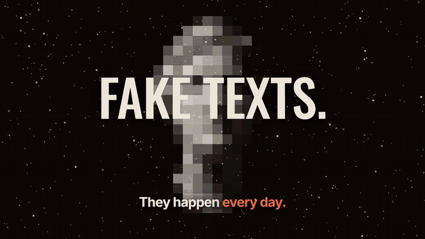
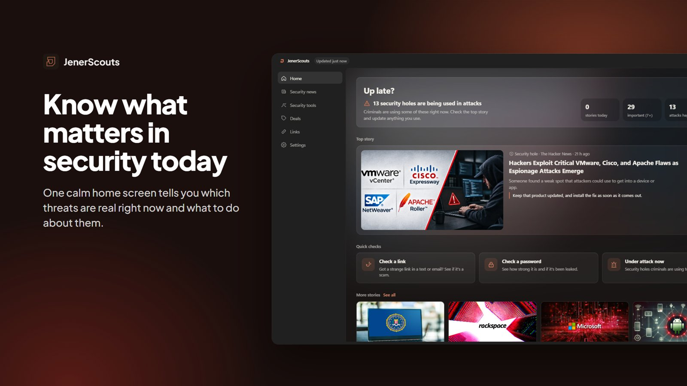
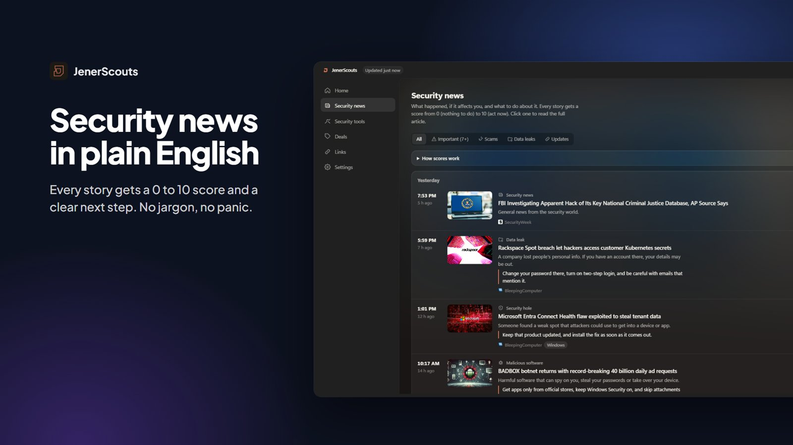
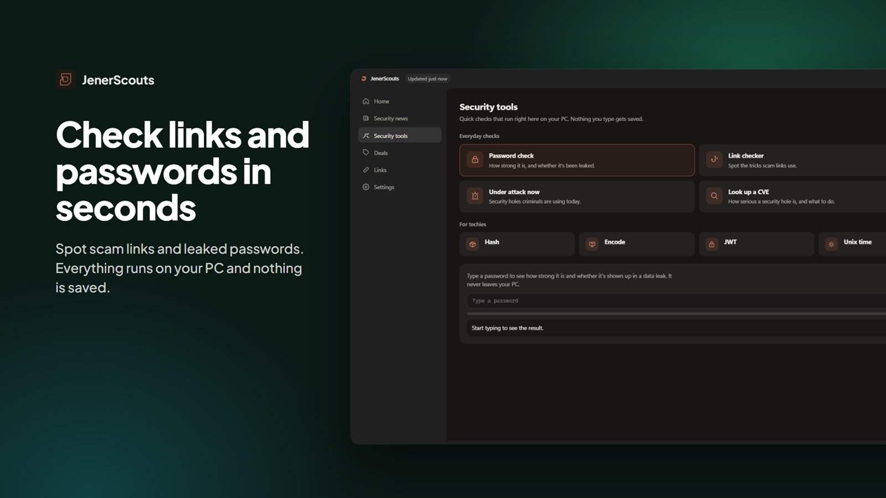
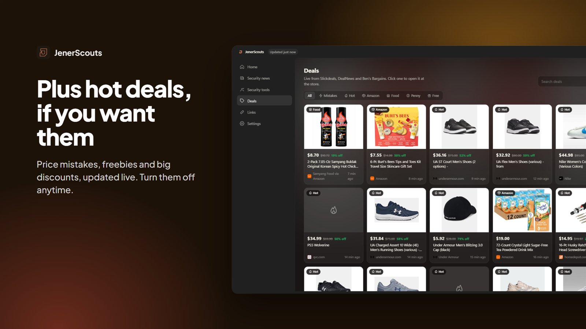

<h1 align="center">JenerScouts</h1>

<h3 align="center">Security news you can actually understand.</h3>

  A free desktop app that tells you what's happening in security today, whether it affects you, 
  and exactly what to do about it. With quick safety checks, and deals if you want them.

  
  
  
  

  <a href="https://github.com/PrimeExtremo/JenerScouts/raw/main/docs/trailer.mp4">Trailer</a> ·
  <a href="#download">Download</a> ·
  <a href="#what-you-get">Features</a> ·
  <a href="#how-the-score-works">The score</a> ·
  <a href="#privacy">Privacy</a> ·
  <a href="https://jener.dev/jenerscouts">jener.dev</a>

  
   
  <a href="https://github.com/PrimeExtremo/JenerScouts/raw/main/docs/trailer.mp4"><b>▶ Watch the full trailer</b></a> (35 s, with sound) · Music: “Circe” by Zak Azoury

  

---

## Download

| Platform | Get it | Updates |
|---|---|---|
| **Windows** (recommended) | [Microsoft Store](https://apps.microsoft.com/detail/9NQFX4G5VV4V) | Automatic, through the Store |
| **Windows** (installer) | [`JenerScouts-Setup-x.y.z.exe`](https://github.com/PrimeExtremo/JenerScouts/releases/latest) | Automatic, signature-checked |
| **Linux** (any distro) | [`.AppImage`](https://github.com/PrimeExtremo/JenerScouts/releases/latest) | Download new versions from Releases |
| **Debian / Ubuntu** | [`.deb`](https://github.com/PrimeExtremo/JenerScouts/releases/latest) | Download new versions from Releases |

No account, no sign-up.

Install notes

- **Windows installer:** SmartScreen may show "Windows protected your PC" because the installer uses JenerDev's own certificate. Click **More info → Run anyway**. The Store version doesn't show this.
- **AppImage:** `chmod +x JenerScouts-*.AppImage`, then double-click it or run it from a terminal.
- **.deb:** `sudo apt install ./JenerScouts-*-linux-amd64.deb`, then open **JenerScouts** from your apps or run `jenerscouts`.
- **Tray:** closing the window keeps JenerScouts in the tray so alerts still arrive. Quit from the tray menu. On GNOME, tray icons need the AppIndicator extension (Ubuntu includes it).

## What you get

### Know what matters today
The home screen shows today's threat level at a glance: how many security holes criminals are using right now, the top story with a clear next step, and quick checks one click away.

### Security news in plain English

Stories from The Hacker News, BleepingComputer, Krebs on Security, SecurityWeek, CISA and more. Every story says **what happened**, **whether it affects you** and **what to do**, with a score from 0 to 10. Filter by Important, Scams, Data leaks or Updates. Stories that name a CVE show it as a chip you can open for the details.

### Quick safety checks

- **Password check:** how strong a password is and whether it has shown up in a data leak. The password never leaves your PC.
- **Link checker:** paste a link from a text or email and see the scam tricks it uses: look-alike names, fake login pages, short links, risky endings.
- **Under attack now:** the security holes criminals are using today, from CISA's Known Exploited Vulnerabilities list.
- **CVE lookup:** any CVE number, explained in plain words with what to do.
- **For techies:** hash, encode/decode, JWT viewer and Unix time.

### A calmer way to read
Stories open in a built-in reader that blocks ads, trackers and pop-ups, and your mouse's back and forward buttons work across the app and the reader. Deal links open in your normal browser.

### Deals, only if you want them

Turn on live deals from Slickdeals, DealNews and Ben's Bargains: price mistakes, freebies, Amazon, food and penny deals, with desktop alerts for the ones you care about. Or leave them off and keep JenerScouts about security.

## How the score works

| Score | Meaning |
|---|---|
| 0–3.9 | Good to know, nothing to do |
| 4–6.9 | Worth a look if you use the product |
| 7–8.9 | Update or follow the advice soon |
| 9–10 | Act now |

When a story names a **CVE**, the score is its official **CVSS** rating from the U.S. National Vulnerability Database. If CISA lists it as actively exploited, it counts as at least 9. Other stories get an estimate based on the kind of story, marked "est."

## Privacy

- No account, no analytics, no tracking.
- Settings, saved links and cached news stay on your device (`%APPDATA%\JenerScouts` on Windows, `~/.config/JenerScouts` on Linux).
- The app only contacts the public news and deal sites it reads, NVD and CISA for security data, Have I Been Pwned for the password check (only the first 5 characters of a hash are sent), public ad-block lists for the reader, and GitHub or the Microsoft Store for updates.
- Some Amazon deal links include an affiliate tag, which supports the app at no cost to you.

Full details: [Privacy policy](https://jener.dev/jenerscouts/privacy) · [Terms of use](https://jener.dev/jenerscouts/terms)

## Built with

Electron 44 and plain JavaScript. The in-app reader runs in its own sandboxed view with no access to the app, the Windows installer only accepts updates signed by JenerDev's certificate, and the packaged app is hardened against tampering.

## Formerly JenerDev

JenerScouts was called **JenerDev** up to version 1.0.6. Older installs update on their own and keep their settings.

---

© JenerDev · <a href="https://jener.dev">jener.dev</a> · Questions or feedback: <a href="mailto:hello@jener.dev">hello@jener.dev</a>

